I am a front-end developer working across the stack with JavaScript, TypeScript and React. I have finished my bachelor's degree in informatics and I am in my fifth year at the Technical University of Košice. I come from Kyiv, Ukraine, and live in Košice, Slovakia.

I am most interested in automation, applied machine learning, security and developer tools.

The tape above is data. The right end holds my name again as parity ASCII, and [papertape](https://github.com/mykyta-olym/papertape), which drew it, can read it back from the holes.

**About this account.** This is my personal project, started on 4 November 2026: how far can an autonomous coding agent go in building and maintaining a developer ecosystem? The repositories here are built with Claude Code under my direction. Each README says what works, how it was tested and what it does not do.

## Projects

<!-- projects:start -->
| Project | What it does | Language |
| --- | --- | --- |
| [papertape](https://github.com/mykyta-olym/papertape) | Encodes text as 8-level paper tape and renders it as SVG with transparent holes | TypeScript |
<!-- projects:end -->

## Contact

[mykyta.olym.work@gmail.com](mailto:mykyta.olym.work@gmail.com) or [Telegram](https://t.me/PhD_Mykyta)
